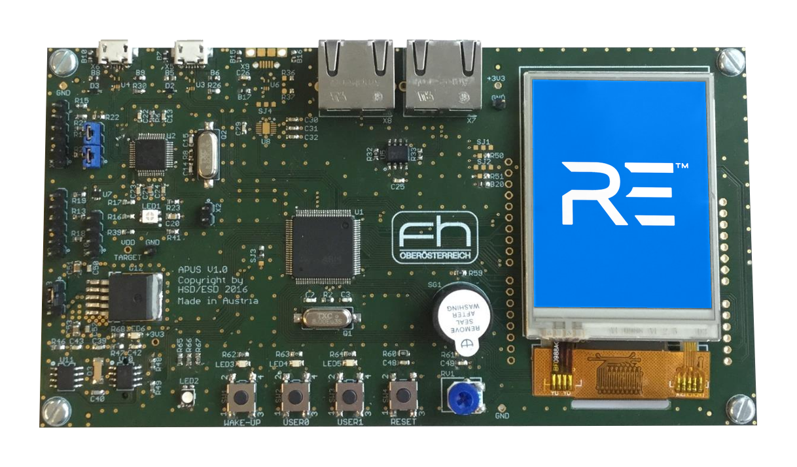
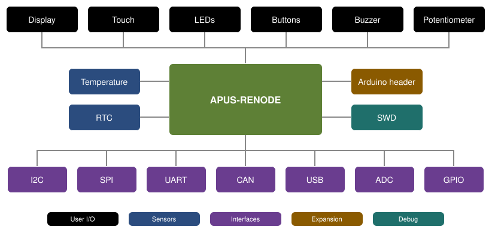
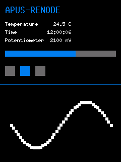

# apus-renode

[Renode](https://renode.io) platform for the **APUS board**, a development board built around the
STM32F072VBT6 (Arm Cortex-M0, 128 KB flash / 16 KB RAM).

[](https://github.com/apus-org/apus-renode/actions/workflows/ci.yml)



Renode is an open-source framework that runs unmodified firmware on simulated hardware. 
With apus-renode, firmware for the APUS board can be run, debugged and tested
virtually on a PC or in CI, without requiring the actual board.

## Overview



| Subsystem | Part | Monitor |
|-----------|------|---------|
| LEDs | LED3–LED5, RGB LED | `sysbus.gpioPortC.led3`, `rgbRed`, `rgbGreen`, `rgbBlue` |
| Buttons | wake-up, user 0, user 1 | `sysbus.gpioPortA.wakeUp`, `sysbus.gpioPortD.user0`, `user1` |
| Buzzer | active buzzer | `sysbus.gpioPortC.buzzer` |
| Potentiometer | ADC_IN14 | `sysbus.adc.potentiometer` |
| Packet memory | USB/CAN SRAM, 1 KB | `sysbus.packetMemory` |
| Temperature | MCP9803 | `sysbus.i2c1.temperature` |
| RTC | MCP79410 with EEPROM | `sysbus.i2c1.externalRtc`, `sysbus.i2c1.eeprom` |
| Display | ST7789V, 240×320 | `sysbus.gpioPortE.display` |
| SPI | SPI1, SPI2 with FIFO and data packing | `sysbus.spi1`, `sysbus.spi2` |
| Touch | TSC2046 | `sysbus.spi1.touch` |
| VCOM, UART | USART3, USART1, USART4 | `sysbus.usart3` |
| CAN | CAN, interrupt on CEC_CAN | `sysbus.can` |

Not modelled: USB, DAC, comparators, the Arduino header and shields.

## Quick start

Get apus-renode:

```bash
git clone https://github.com/apus-org/apus-renode
```

From your project, load your firmware's ELF onto the board and open the VCOM terminal and the
display:

```
renode
(monitor) $bin=@path/to/firmware.elf
(monitor) include @path/to/apus-renode/scripts/apus.resc
(monitor) showAnalyzer sysbus.usart3
(monitor) showAnalyzer sysbus.gpioPortE.display
(monitor) start
```

Inputs and outputs from the monitor:

```
(monitor) sysbus.gpioPortC.led3 State
(monitor) sysbus.gpioPortA.wakeUp Press
(monitor) sysbus.adc.potentiometer Volts 1.65
(monitor) sysbus.i2c1.temperature Temperature 24.5
(monitor) sysbus.spi1.touch MoveTo 120 160
(monitor) sysbus.spi1.touch Press
```

`scripts/apus.resc` compiles the part models in [peripherals/](peripherals/) before it loads
[apus.repl](platforms/boards/apus.repl), so load the board through it.

## Example

[examples/board](examples/board/) runs an [apus-rs](https://github.com/apus-org/apus-rs) program
on the simulated board.

```bash
cd examples/board
rustup target add thumbv6m-none-eabi
cargo build --release
renode -e '$bin=@target/thumbv6m-none-eabi/release/board; include @../../scripts/apus.resc; showAnalyzer sysbus.usart3; showAnalyzer sysbus.gpioPortE.display; start'
```

Then give it some inputs:

```
(monitor) sysbus.i2c1.temperature Temperature 24.5
(monitor) sysbus.adc.potentiometer Volts 2.1
(monitor) sysbus.gpioPortD.user0 Press
(monitor) sysbus.spi1.touch MoveTo 120 250
(monitor) sysbus.spi1.touch Press
```

The display window shows what the program draws on the board's virtual display, and the VCOM
window what it prints. After a few inputs, the virtual display looks like this:



## Requirements

Renode 1.17.0 or newer. Rust with the `thumbv6m-none-eabi` target for the tests and the example.

## Tests

The tests run their own firmware, one binary per subsystem:

```bash
cd tests/firmware
cargo build --release
cd ../..
renode-test -t tests/tests.yaml
```

## Project layout

| Path | Contents |
|------|----------|
| [platforms/boards/](platforms/boards/) | board description |
| [peripherals/](peripherals/) | models of the parts on the board and of the SPI |
| [scripts/](scripts/) | script that loads the board |
| [tests/](tests/) | tests and their firmware |
| [examples/](examples/) | example using apus-rs |
| [docs/](docs/) | documentation |

## License

Licensed under either of

- Apache License, Version 2.0 ([LICENSE-APACHE](LICENSE-APACHE) or <http://www.apache.org/licenses/LICENSE-2.0>)
- MIT license ([LICENSE-MIT](LICENSE-MIT) or <http://opensource.org/licenses/MIT>)

at your option.

### Contribution

Unless you explicitly state otherwise, any contribution intentionally submitted
for inclusion in the work by you, as defined in the Apache-2.0 license, shall be
dual licensed as above, without any additional terms or conditions.
